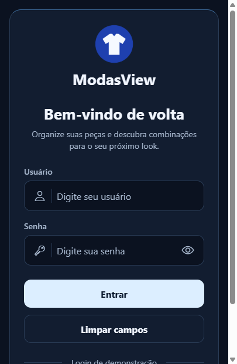
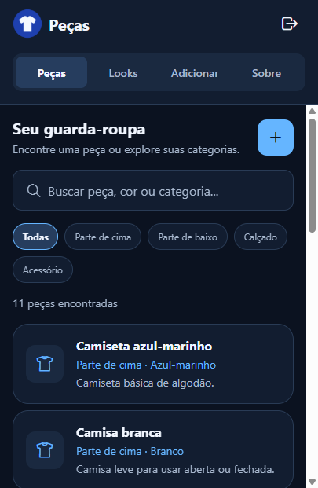
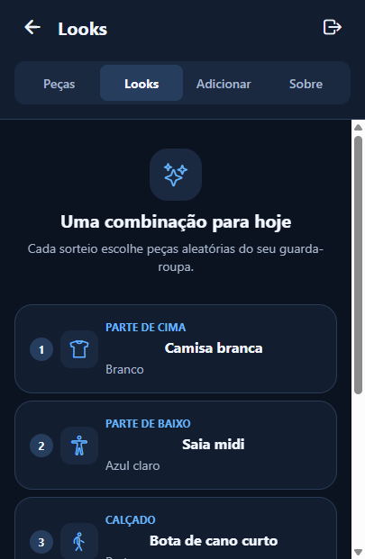
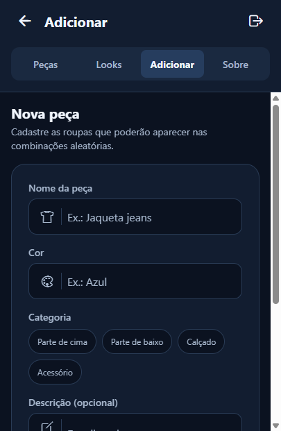
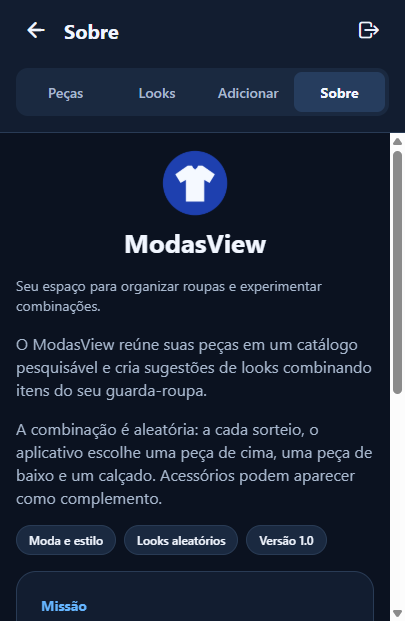

# ModasView

**Aluno:** Augusto Neres  
**Aplicação:** ModasView  
**Disciplina:** Programação para Dispositivos Móveis I

## Sobre o aplicativo

O ModasView ajuda a organizar peças de roupa e experimentar combinações de looks. A interface usa tons de azul, e o catálogo inicial é carregado de um arquivo JSON local.

## Funcionalidades

- **Peças:** lista pesquisável por nome, categoria, cor ou descrição, com filtros por categoria.
- **Looks:** sorteia uma peça de cima, uma peça de baixo e um calçado; um acessório pode ser incluído no sorteio.
- **Adicionar:** formulário para inserir nome, cor, categoria e descrição opcional.
- **Sobre:** explica o objetivo e o funcionamento do aplicativo.
- **Login demonstrativo:** credenciais fixas e sem sessão persistente.

## Dados

O catálogo inicial está em `src/data/pecas.json`. Peças adicionadas pelo formulário ficam no estado em memória enquanto o app estiver aberto; elas não são gravadas no arquivo JSON e desaparecem ao fechar o aplicativo. Essa escolha mantém o funcionamento sem banco, API ou armazenamento persistente.

## Como executar

Requisitos: Node.js compatível com a versão instalada do Expo e Expo Go para testar em Android.

```bash
npm install
npx expo install --fix
npx expo start
```

Pressione `a` para abrir no emulador Android ou `w` para abrir no navegador.

## Credenciais demonstrativas

| Campo | Valor |
|---|---|
| Usuário | `aluno` |
| Senha | `123456` |

## Estrutura

```text
src/
├── app/                  # rotas do Expo Router
│   ├── index.jsx         # Login
│   └── (app)/            # área protegida
│       ├── home.jsx      # catálogo e busca de peças
│       ├── looks.jsx     # combinações aleatórias
│       ├── adicionar.jsx # inserção de peças
│       └── sobre.jsx
├── components/           # Button, Input, Toolbar, BrandLogo e layout
├── config/               # credenciais e categorias
├── context/              # autenticação e catálogo em memória
├── data/pecas.json       # catálogo inicial
├── pages/                # telas e estilos
└── styles/               # cores, fontes e estilos globais
```

## Capturas

### Login


### Peças


### Looks


### Adicionar peça


### Sobre


## Uso de Inteligência Artificial

O Copilot SDK em VS Code foi usado como apoio para adaptar o tema do aplicativo, criar a identidade visual e implementar as telas de catálogo, sorteio de looks e inclusão de peças. O aluno deve complementar esta seção com as demais ferramentas usadas e as contribuições realizadas pessoalmente, conforme as regras da disciplina.
